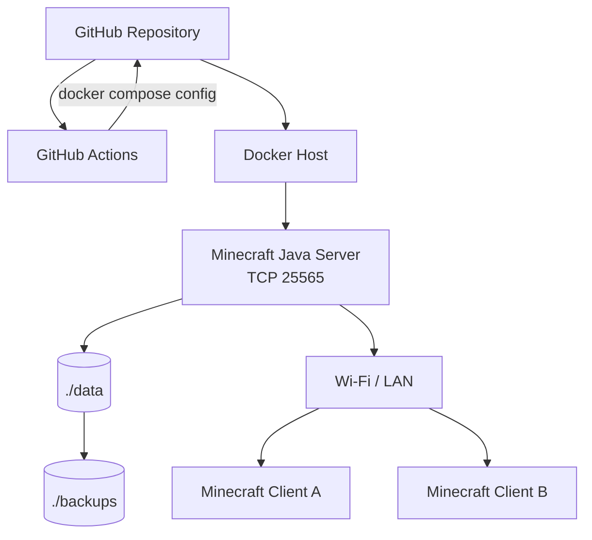

# Architecture

## Scope

このラボの初期スコープは「宅内 LAN 上で動く Minecraft Java Server」です。

インターネット公開、認証回避、RCON の外部公開は対象外です。

## Logical Architecture



## Network Boundary

Minecraft クライアントが接続するのは Docker Host の LAN IP と TCP/25565 です。

例:

```text
192.168.1.20:25565
```

Docker Compose は `25565:25565/tcp` を Host に公開しますが、家庭用ルーター側で WAN からの Port Forwarding を設定しなければ、通常はインターネットから直接到達しません。

ただし Host OS の Firewall 設定は別レイヤーなので、必要に応じて LAN セグメントだけを許可してください。

## RCON

RCON はバックアップ時の整合性確保のために有効化します。

- Container 内: 有効
- Host の TCP/25575: 公開しない
- WAN: 公開しない

これにより `rcon-cli save-all flush` / `save-off` / `save-on` を Container 内から利用できます。

## Persistence

```text
./data <-> /data
```

Minecraft の world、server.properties、whitelist、ops などは `./data` に保存されます。

Container を再作成しても `./data` が残るため、ゲーム状態を維持できます。

## Failure Domains

初期構成は単一 Docker Host なので、以下は単一障害点です。

- Docker Host
- Host Storage
- Wi-Fi / LAN

学習用として意図的に単純化しています。

## Future Extensions

- Prometheus / Grafana
- Loki / log aggregation
- Backup retention
- Restore test
- UPS / graceful shutdown
- Ansible による Host provisioning
- Terraform を使った Cloud 版
- GitHub Actions からの controlled deployment
